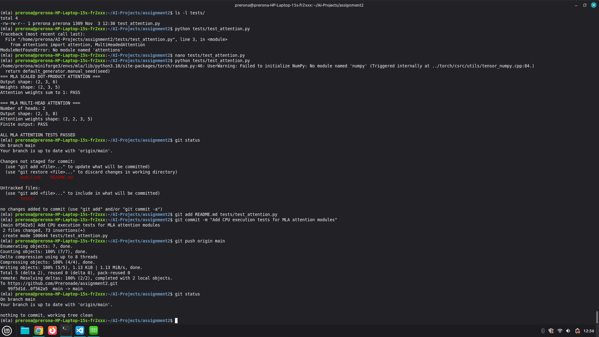
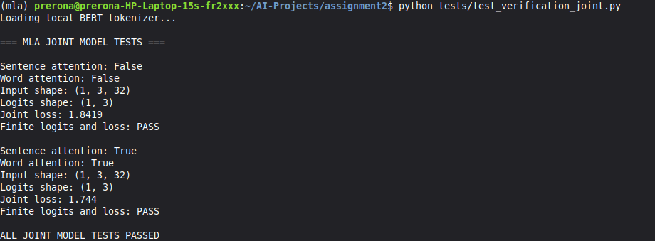
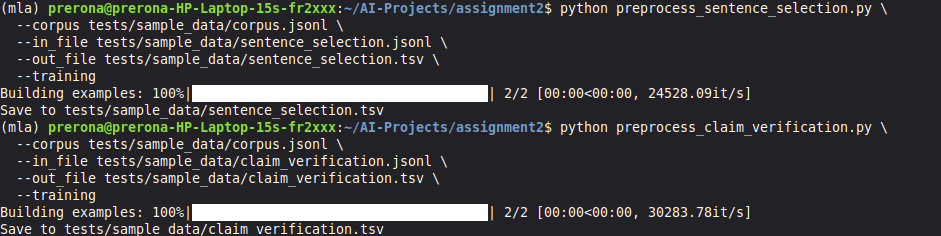
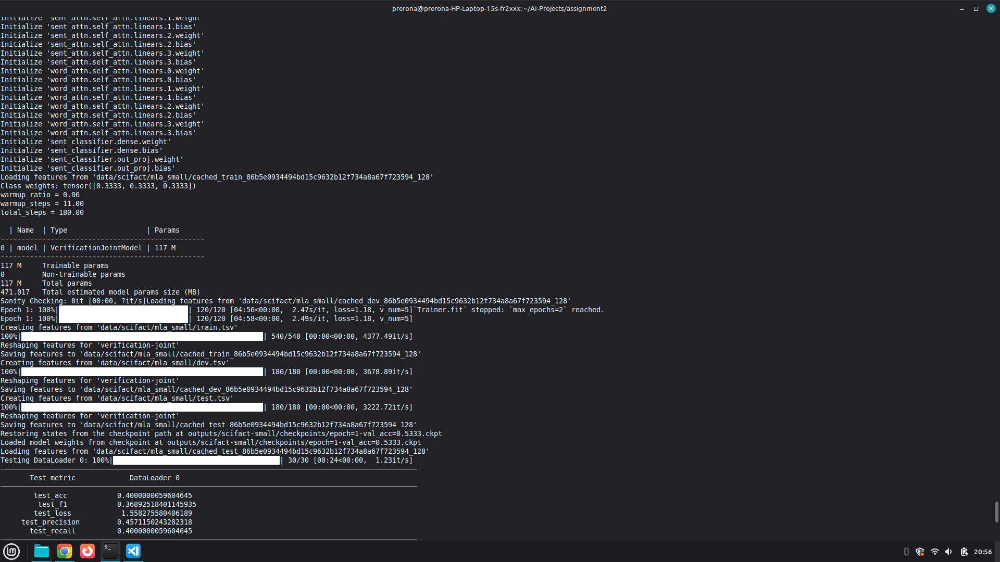

# A Multi-Level Attention Model for Evidence-Based Fact Checking

This repository contains the implementation and CPU-based execution tests of the Multi-Level Attention (MLA) model.

## Environment

- Python 3.10
- PyTorch 2.0.1 (CPU)
- Transformers 4.40.2
- NumPy 1.26.4

## Execution Evidence

### 1. Attention Module Test

Run:

```bash
python tests/test_attention.py
```

Verified:
- Scaled dot-product attention
- Attention weight normalization
- Multi-head attention
- Output tensor validation



### 2. Joint Verification Model Test

Run:

```bash
python tests/test_verification_joint.py
```

Verified:
- Original BERT-based verification model
- Evidence-selection classifier
- Joint loss calculation
- Sentence-level attention
- Word-level attention
- Claim-evidence aggregation attention
- Finite logits and loss



### 3. Preprocessing Test

The original preprocessing scripts were executed using synthetic JSONL examples.

Verified:
- Sentence-selection preprocessing
- Claim-verification preprocessing
- TSV output generation
- Evidence-selection labels and padding



### 4. Small SciFact Training and Evaluation

A small-scale experiment was conducted to verify the end-to-end MLA training and evaluation pipeline on CPU.

**Dataset:**
- Training: 90 claims (30 per class)
- Development: 30 claims (10 per class)
- Testing: 30 claims (10 per class)
- Evidence slots: 5 per claim

**Training configuration:**
- Model: VerificationJointModel
- Aggregation: Attention
- Sentence-level and word-level attention: Enabled
- Maximum sequence length: 128
- Batch size: 1
- Epochs: 2
- Learning rate: 2e-5
- Hardware: CPU

**Test results:**

| Metric | Result |
|---|---:|
| Accuracy | 40.00% |
| F1 | 36.89% |
| Precision | 45.71% |
| Recall | 40.00% |
| Test loss | 1.5583 |

Training completed successfully. The best checkpoint was saved locally at `outputs/scifact-small/checkpoints/epoch=1-val_acc=0.5333.ckpt`.

## Limitations

- This is a small-scale SciFact experiment, not an official benchmark evaluation.
- The 30-example test subset was sampled from the official SciFact development data, not the official test split.
- Evidence candidates were prepared using a simplified small-data workflow rather than the complete original retrieval pipeline.
- Training used two epochs and CPU execution only.
- The reported metrics should not be compared directly with published benchmark results.
- Model checkpoints and generated feature caches are local artifacts and are not included in the repository.

